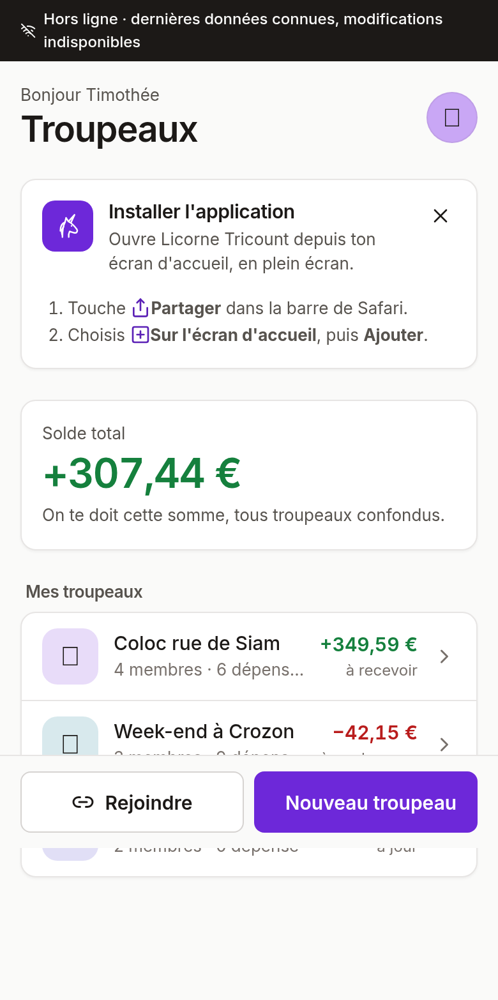
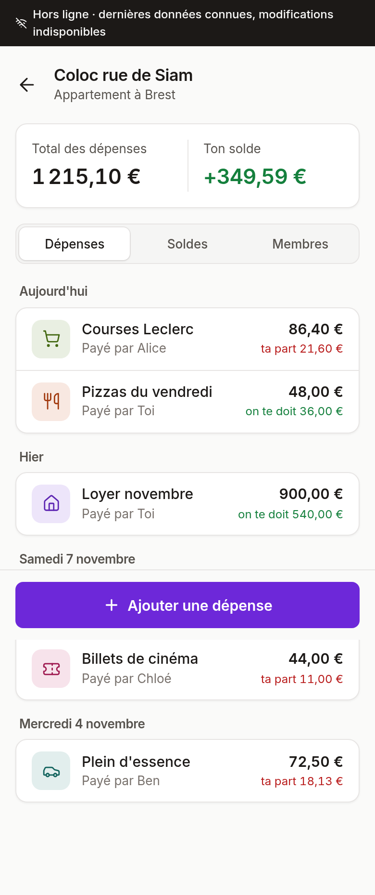
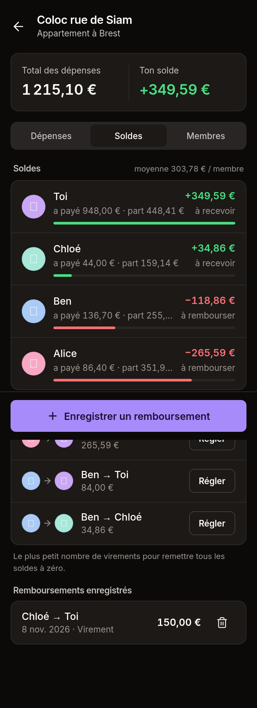

# Licorne Tricount

Application web de partage de dépenses en groupe, installable sur l'écran d'accueil d'un iPhone ou
d'un Android (PWA). Chaque dépense est répartie automatiquement selon la part de chacun, catégorie
par catégorie : le logement ne se partage pas forcément comme les courses.

API **NestJS + Prisma + PostgreSQL**, front **Vue 3 + Vite + TypeScript**, le tout sous **Docker**.

<p>
  
  
  
</p>

## Fonctionnalités

- **Comptes** : inscription, connexion, session de 30 jours renouvelée automatiquement, profil
  (photo, ou avatar licorne et couleur).
- **Double authentification** facultative (Profil → Sécurité) : codes TOTP à 6 chiffres
  (Mots de passe d'iPhone, Google Authenticator, 1Password…) et 10 codes de secours.
- **Troupeaux** (groupes) : création, code d'invitation à partager, membres, rôles créateur et membre,
  photo et bannière personnalisables.
- **Familles** : plusieurs membres d'une même famille comptent pour une seule entité dans le
  troupeau (un coefficient commun partagé à parts égales, un solde commun, des remboursements communs).
  Chacun garde son compte et peut payer des dépenses.
- **Coefficients** : une matrice membre × catégorie en pourcentages (40 % du logement, 25 % des courses…).
  Un coefficient de 0 % exclut la personne de la catégorie.
- **Dépenses** : répartition automatique selon les coefficients, ou personnalisée pour une dépense
  (parts égales, par parts, montants exacts). Dépenses groupées par jour.
- **Soldes** et **remboursements suggérés** : le plus petit nombre de virements pour tout remettre à zéro.
- **Remboursements enregistrés**, avec historique.
- **PWA** : installation sur l'écran d'accueil, consultation hors ligne des dernières données,
  mise à jour proposée quand une nouvelle version est déployée.
- **Thème clair et sombre** selon le réglage du téléphone.
- **Format ordinateur** (à partir de 1 024 px) : barre latérale avec les troupeaux et le profil ;
  dans un troupeau, les dépenses à gauche et les soldes ou les membres à droite.

Tous les montants sont manipulés en **centimes entiers** ; la somme des parts est toujours égale au
montant (méthode du plus fort reste). Les coefficients sont stockés en **points de base**
(10 000 = 100 %).

## Démarrage rapide (Docker)

```bash
docker compose up --build
```

| Service | Adresse |
| --- | --- |
| Application | http://localhost:8080 |
| API | http://localhost:3000/api |
| Documentation de l'API (Swagger, hors production) | http://localhost:3000/api/docs |
| Sonde de santé | http://localhost:3000/api/health |
| PostgreSQL | localhost:5432 (`licorne` / `licorne`) |

Les migrations sont appliquées automatiquement au démarrage de l'API. Une base créée par une version
précédente (avec `prisma db push`) est reconnue et raccrochée à l'historique des migrations.

Données de démonstration :

```bash
docker compose exec api npx ts-node prisma/seed.ts
```

Comptes : `sophie@licorne.fr`, `leo@licorne.fr`, `maya@licorne.fr`, `timothee@licorne.fr`,
mot de passe `licorne123`, code d'invitation `BROCEL22`.

## Développement sans Docker

Il faut un PostgreSQL (par exemple `docker compose up db`).

```bash
# API
cd backend
cp .env.example .env
npm install
npx prisma migrate deploy
npm run start:dev          # http://localhost:3000/api

# Front
cd frontend
npm install
npm run dev                # http://localhost:5173, /api est redirigé vers l'API
```

Pour modifier le schéma : éditer `prisma/schema.prisma`, puis `npx prisma migrate dev --name <nom>`.

## Installer l'application sur un téléphone

L'installation exige une adresse **HTTPS** : elle sera possible une fois l'application déployée
(par exemple sur `tricount.timotheebenchergui.fr`).

- **iPhone** (iOS 16.4 ou plus) : ouvrir le site dans Safari, toucher **Partager**, puis **Sur l'écran d'accueil**.
  L'application affiche ce mode d'emploi elle-même.
- **Android** (Chrome) : toucher le bouton **Installer** proposé par l'application, ou le menu de Chrome.

## Tests

```bash
cd backend && npm test
```

65 tests unitaires : répartition au centime près, soldes et simplification des dettes,
normalisation des coefficients, familles (entités), traitement des photos, validation de la
configuration, rotation des sessions, double authentification.

## Sécurité

- Jeton d'accès de 15 minutes gardé en mémoire ; jeton de rafraîchissement de 30 jours en cookie
  `HttpOnly`, `SameSite=Lax`, `Secure` en production, avec rotation à chaque usage et coupure de
  toutes les sessions en cas de réutilisation.
- Mots de passe hachés avec bcrypt (coût 12), 10 caractères minimum.
- Double authentification TOTP : secret chiffré en base (AES-256-GCM, clé `ENCRYPTION_KEY`),
  chaque code accepté une seule fois, codes de secours hachés et à usage unique, deuxième étape
  limitée à 5 essais par minute. Ne jamais changer `ENCRYPTION_KEY` une fois en production.
- Limitation de débit : 120 requêtes par minute, 10 par minute sur la connexion et l'inscription.
- En-têtes de sécurité (helmet côté API, CSP et compagnie côté nginx), corps de requête limités.
- Configuration validée au démarrage : l'API refuse un secret JWT faible en production.
- Un non-membre reçoit 404 sur un troupeau, sans indication sur son existence.
- Images Docker multi-étapes, exécutées sans privilèges, avec sonde de santé.

Variables d'environnement : voir [`backend/.env.example`](backend/.env.example).

## Structure

```
licorne-tricount/
├── docker-compose.yml
├── backend/
│   ├── Dockerfile, docker-entrypoint.sh   # migrations puis démarrage
│   ├── prisma/
│   │   ├── schema.prisma
│   │   ├── migrations/                    # 0_init … 3_two_factor
│   │   └── seed.ts
│   └── src/
│       ├── config/          # validation des variables d'environnement
│       ├── auth/            # JWT, sessions à rafraîchissement, guard global
│       ├── health/          # GET /api/health
│       ├── families/        # familles et calculs par entité (parties.util.ts)
│       ├── uploads/         # photos : recadrage WebP (sharp), servies sous /api/uploads/
│       ├── users/  groups/  expenses/  balances/  coefficients/  settlements/
│       └── common/          # répartition au centime, catégories
└── frontend/
    ├── nginx.conf           # SPA, en-têtes de sécurité, proxy /api
    ├── public/icons/        # icônes PWA
    └── src/
        ├── api/             # client fetch (renouvellement de session automatique)
        ├── stores/          # Pinia : auth, groups, toast, confirm
        ├── views/           # 10 écrans
        ├── components/      # en-tête, lignes de liste, avatars, PWA, confirmation…
        ├── utils/           # formats, catégories, installation PWA
        └── styles/main.css  # système de design (jetons clairs et sombres)
```

## API

Toutes les routes sont préfixées par `/api` et exigent un jeton, sauf l'inscription, la connexion,
le renouvellement de session, la déconnexion et la sonde de santé.

| Méthode | Route | Description |
| --- | --- | --- |
| POST | `/auth/register`, `/auth/login` | Créer un compte, se connecter |
| POST | `/auth/login/2fa` | Deuxième étape de connexion (code ou code de secours) |
| POST | `/auth/refresh`, `/auth/logout` | Renouveler ou fermer la session (cookie) |
| GET | `/auth/2fa` | État de la double authentification |
| POST | `/auth/2fa/setup`, `/auth/2fa/enable`, `/auth/2fa/disable`, `/auth/2fa/recovery-codes` | Activer, désactiver, renouveler les codes de secours |
| GET | `/auth/me` | Utilisateur connecté |
| PATCH | `/users/me` | Modifier nom, avatar, couleur |
| PUT / DELETE | `/users/me/avatar` | Photo de profil (multipart, champ `file`) |
| GET / POST | `/groups` | Lister, créer un troupeau |
| POST | `/groups/join` | Rejoindre avec un code |
| GET / PATCH / DELETE | `/groups/:id` | Lire, modifier, supprimer |
| POST | `/groups/:id/invite-code` | Régénérer le code d'invitation |
| PUT / DELETE | `/groups/:id/photo`, `/groups/:id/banner` | Photo (carrée) et bannière (3:1) du troupeau |
| POST | `/groups/:id/families` | Créer une famille |
| PATCH / DELETE | `/groups/:id/families/:familyId` | Modifier ou dissoudre une famille |
| DELETE | `/groups/:id/members/:userId` | Quitter ou retirer un membre |
| GET | `/groups/:id/balances` | Soldes et remboursements suggérés |
| GET / PUT | `/groups/:id/coefficients` | Matrice des coefficients |
| POST | `/groups/:id/coefficients/apply` | Recalculer les dépenses automatiques |
| GET / POST | `/groups/:id/expenses` | Lister, ajouter |
| GET | `/groups/:id/expenses/stats` | Totaux par catégorie |
| GET / PATCH / DELETE | `/groups/:id/expenses/:expenseId` | Lire, modifier, supprimer |
| GET / POST | `/groups/:id/settlements` | Lister, enregistrer un remboursement |
| DELETE | `/groups/:id/settlements/:settlementId` | Supprimer un remboursement |
| GET | `/health` | Sonde de santé |

## Calculs

```
part d'une entité = montant × son coefficient dans la catégorie   (plus fort reste au centime)
part d'un membre  = part de sa famille ÷ nombre de membres        (s'il est dans une famille)
solde             = payé − dû + remboursements envoyés − remboursements reçus
```

Une entité est une famille ou un membre seul. Le coefficient d'une famille est la somme de ceux de
ses membres ; les soldes et les remboursements suggérés sont calculés par entité, donc deux membres
d'une même famille ne se remboursent jamais entre eux.

Un solde positif signifie qu'on doit de l'argent au membre. La somme des soldes d'un troupeau est
toujours nulle. Les remboursements suggérés apparient le plus gros débiteur au plus gros créancier,
soit au plus n − 1 virements pour n membres.

## Publier sur GitHub

Le dépôt Git est déjà initialisé. Après avoir créé un dépôt vide sur GitHub :

```bash
git remote add origin git@github.com:<utilisateur>/licorne-tricount.git
git push -u origin main
```
